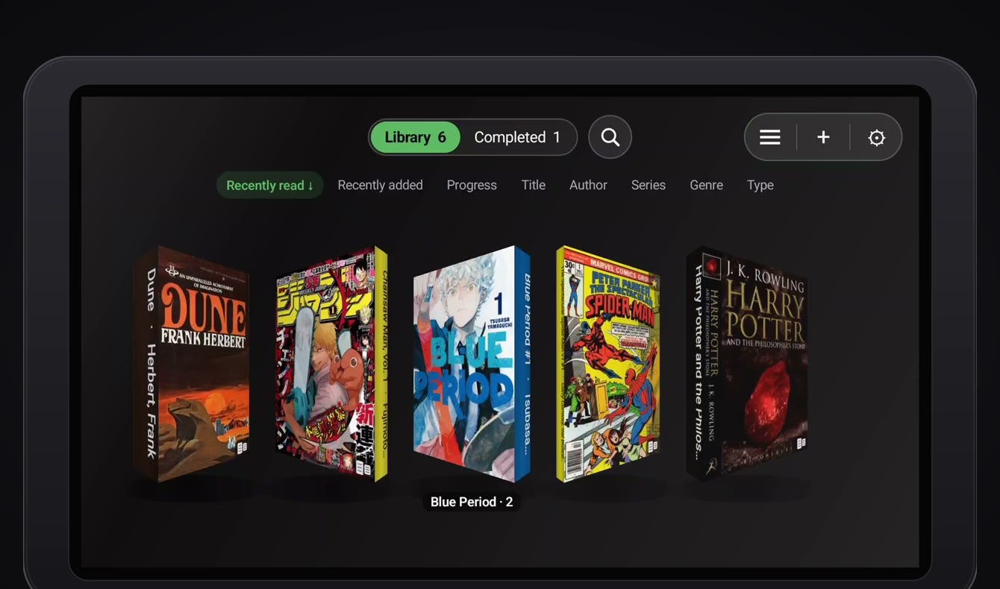
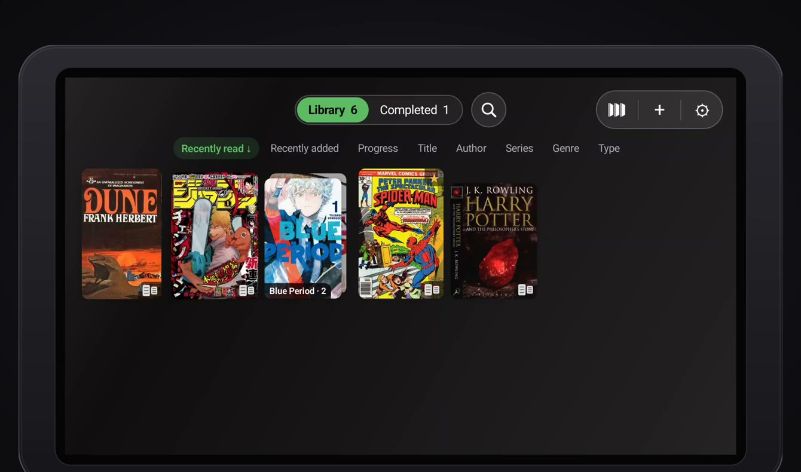
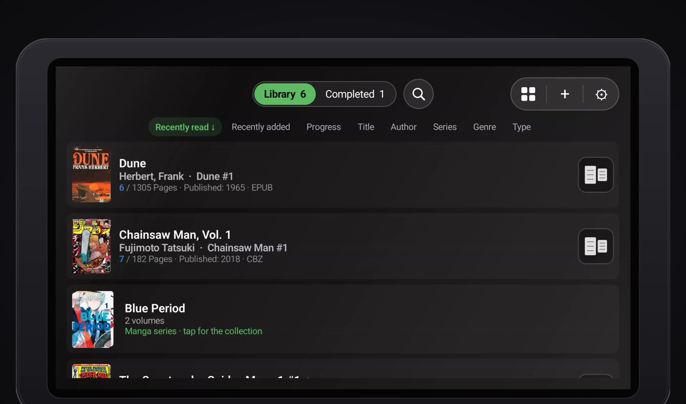
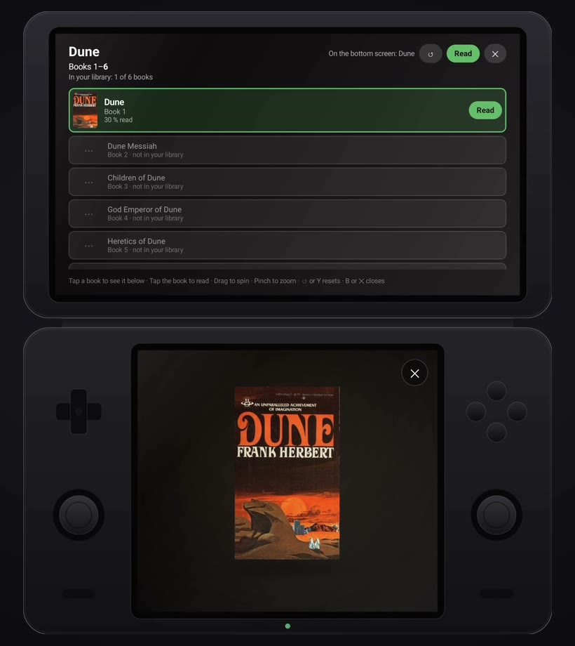
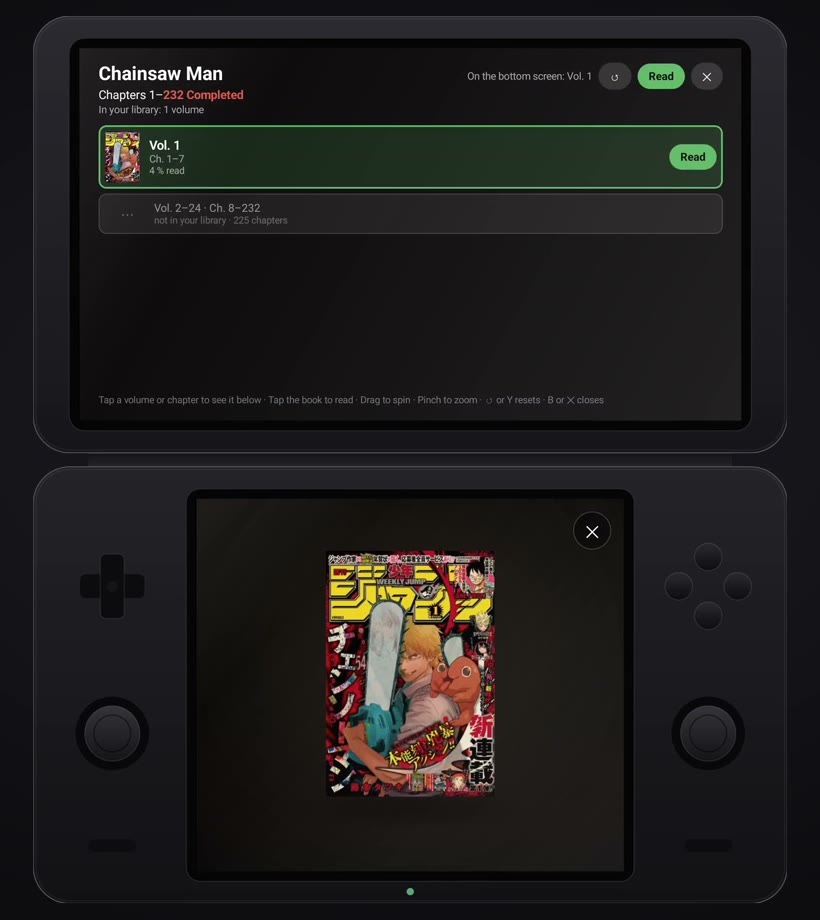
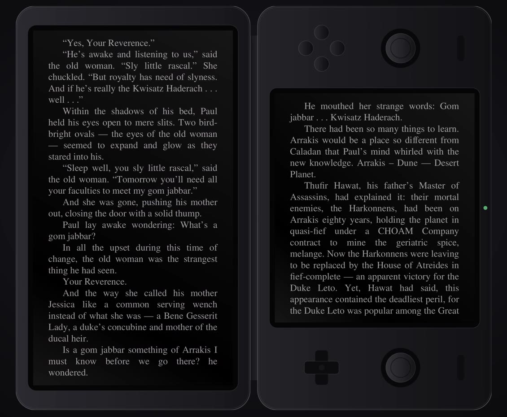
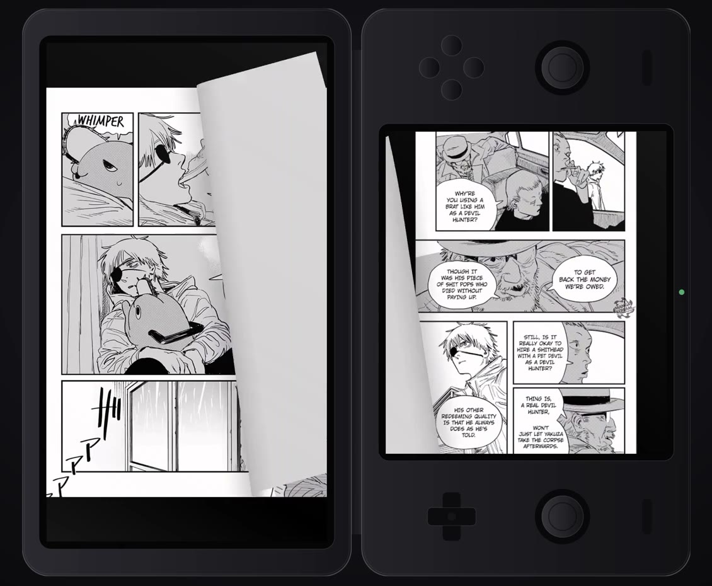
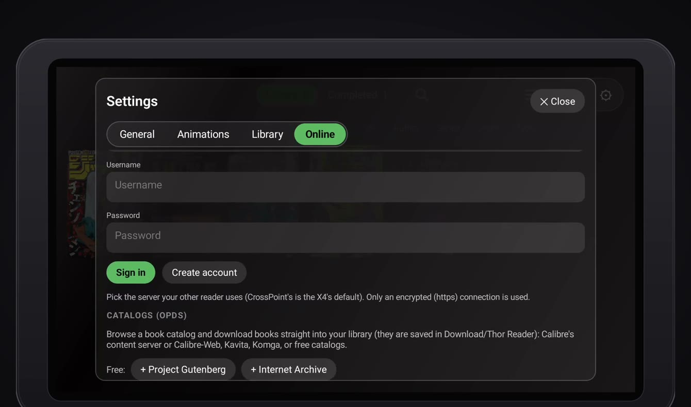

# Thor Reader

A reading app designed for the AYN Thor to read books, comics, and manga in whatever
orientation you want.

Thor Reader is made for the **AYN Thor**, the dual-screen Android clamshell handheld. It uses both
screens the way a book would: hold the Thor sideways and the two screens become the two pages
of an open book, or keep it closed-clamshell style and read on one screen while the other stays
free for something else.

**New in 0.3:** three library views (List, Grid, Cover flow), series collections for books and
manga, a 3D Inspect view, page-turn and open/close animations, reading progress sync with
CrossPoint / KOReader, OPDS catalogs and burn-in protection - see [CHANGELOG.md](CHANGELOG.md).

## Screenshots

Recorded on an AYN Thor (shown in a drawn device frame).

| | |
|---|---|
|  **Cover flow** - the library as books standing turned, spine and cover |  **Grid** - covers with a tab for the mode each book opens in |
|  **List** - title, author, series, pages and format |  **Inspect** - a 3D book on the bottom screen, its series (with the books you're missing) on top |
|  **Manga collections** - volumes, chapters, gaps and "Completed" / "Ongoing" |  **Book mode** - hold the Thor sideways: two screens, two pages |
|  **Page curl** - the sheet turns across the hinge (or flip, slide, fade) |  **Online** - reading progress sync with CrossPoint / KOReader, and OPDS catalogs |

## Reading modes

Each book remembers its own mode. Switch from the reader menu.

| Mode | How you hold it | What you see |
|---|---|---|
| 1. Book | Sideways, top screen on the left | Left page on the top screen, right page on the bottom screen |
| 2. Book reversed | Sideways the other way | Left page on the bottom screen, right page on the top screen |
| 3. Top screen | Normally | A two-page spread on the top screen; the bottom screen is free |
| 4. Bottom screen | Normally | One page (or two) on the bottom screen; the top screen is free |

## Features

- Books are laid out to the exact size of each screen; no line is ever cut between pages.
- Running chapter header and page numbers, in the book's own font.
- Themes: Paper, Sepia, and Night (pure black with grey text, for OLED).
- Comics and manga: fit-to-screen, double-page spreads split across both screens in book
  modes, right-to-left reading (auto-detected from ComicInfo.xml, or set per series),
  double-tap and pinch zoom. In book modes, swipe up on the small screen's page to see it on
  the big screen; swipe up again on the big screen to swap back. Buttons: d-pad right or Y in
  Mode 1, Y in Mode 2.
- Quick navigation: page scrubber, go to page, chapter list, and "back to where I was".
- Page turns by tap, swipe, d-pad and shoulder buttons (hold to flip quickly), always in the
  physically right direction for the current mode. In right-to-left manga the shoulders are
  swapped by default so the easy one goes forward ("Swap L1/R1 for manga" in the reader menu).
- Page-turn animations (reader menu, "Page turn"): a realistic paper curl drawn on the GPU,
  Flip, Slide, Fade or None, per book if you like, at Fast / Normal / Slow speed. Buttons and
  taps curl the page from its bottom (or top) outer corner. In the book
  modes one sheet turns across the hinge from one screen to the other; swipes make the page
  follow your finger. Held buttons and jumps use a quick slide; below 15 % battery pages fade.
- Opening a book lifts its cover out of the library and swings it open across the screens (and
  closes it back into its row); Settings: "Open & close animation".
- Inspect a book (popup on its mode button): a 3D book with the real cover, a spine, the back
  cover and its thickness; spin it, zoom, and read its details on the bottom screen.
- Theme colour: pick the app's accent colour in Settings (8 colours or any hue).
- Reading position, mode and text settings are remembered per book.
- Book modes can use a different text size on each screen ("Same text size on both screens" off
  in the reader menu); the text still flows from one screen to the next without losing a line.
- Library: "Library | Completed" switch, search, and one row to sort the list (Recently read,
  Recently added, Progress, Title) or group it (Author, Series, Genre, Type: Books / Manga /
  Comics); tap the active option again to reverse it. Names in the Author, Series and Genre
  lists can be hidden (swipe left or hold; Settings shows them again), and you can add an
  author or series to books yourself ("+ Add author" / "+ Add series"). Each row shows where you are, the page
  count, the year first published and the format ("277 / 1794 Pages · Published: 1965 · EPUB");
  finished books get a gold star and are also listed under "Completed". Works with the d-pad
  and A/B as well as touch.
- Typing (search, Edit info, Settings) happens on a built-in keyboard on the bottom screen, so
  the list on the top screen stays visible and filters as you type. D-pad + A to type, B to
  delete, Start for Done; a physical or Bluetooth keyboard also works.
- A bookmark per book, shown as a ribbon on the page (choose its colour; swipe it up to remove).
  Closing the lid or leaving the app bookmarks your page automatically, and the ribbon slides
  away again when you come straight back.
- A short first-run tutorial (can be shown again from the reader menu).

## Supported formats

- **Books:** EPUB, MOBI, AZW, AZW3 (KF8), FB2, TXT, HTML / HTM / XHTML, Markdown (.md), DOCX,
  ODT, RTF.
- **Fixed layout:** PDF, XPS.
- **Comics / manga:** CBZ, CBR (RAR4), CB7, CBT, single pictures (JPG, PNG, WEBP, GIF, AVIF), and
  a folder of pictures added with "Add folder" (shown as one comic).

Kindle books (MOBI / AZW / AZW3) must be DRM-free; DRM-protected books show "This book is
DRM-protected". Pictures next to an HTML or Markdown file are shown when the file was added
with "Add folder" (Android only lets apps see a file's neighbours then).

## Book info (looked up online)

Thor Reader fills in missing book details - authors, series, genres, a description, and
whether something is a book, manga or comic - by looking them up online. Only these details
are looked up; your books never leave the device and their files are never changed. You can
correct anything with **Edit info** (in a book's popup in the library); what you change by
hand is never overwritten. Turn it off in **Settings** (the ⚙ in the library).

- **Manga** (AniList) and **books** (Open Library) work automatically, no account needed.
  Japanese manga found this way read right-to-left automatically (unless you set a direction).
- **Comics** (ComicVine) need a free ComicVine API key, and every person needs their own:
  ComicVine limits how often one key may be used, so a key can't be shared or built into the app.
  1. In the library, tap ⚙ (Settings), then **Get a free key**. This opens
     https://comicvine.gamespot.com/api in the browser.
  2. Create a free account, then copy the key shown on that page.
  3. Paste it into **ComicVine key**, tap **Save key**, then **Test key** ("Key works").
  The key is stored encrypted on the device. Comics that contain a ComicInfo.xml (for example
  tagged with ComicTagger) use that information without a key.
- Books that couldn't be matched confidently show under **Needs review** in the library.

## Privacy & security

**No tracking.** Thor Reader has no analytics, no ads, no crash reporting and no background
work. It never sends your books or your library anywhere. Your reading position is only sent
if you sign in to reading progress sync yourself (Settings › Online), and only to the sync
server you chose.

**What it can access**

- Only the files and folders you pick with **Add files** / **Add folder** (Android's file
  picker). It has no storage permission, reads your files in place and never changes them.
- Its own private storage: the library database, cover pictures, and caches it can re-create
  (unpacked comics, page layouts, converted books, saved online answers - limit and
  **Clear cache** in Settings).
- Permissions: Internet (book info, sync and catalogs), network state (to retry a lookup when
  you're back online) and vibration (the small tick at the end of a book). Nothing else.

**Network calls** - book info only when **Look up book info online** is on (Settings), HTTPS
only:

| Service | When | What is sent |
|---|---|---|
| graphql.anilist.co | manga and unlabelled comics | the series name |
| openlibrary.org, covers.openlibrary.org | books | the title and author, or the ISBN; cover download |
| comicvine.gamespot.com | comics, only if you entered a key | the series name and issue number, your key |
| en.wikipedia.org | manga series collections | the series name |
| www.wikidata.org, query.wikidata.org | book series collections | the series name, or a book's title (for a book with no series) |

Each book is looked up once, answers are cached (30 days for book info), and failures are
retried later (never in a loop). Book content never leaves the device.

Two features you switch on yourself in **Settings › Online**:

| Service | When | What is sent |
|---|---|---|
| Your sync server (CrossPoint, KOReader or your own) | only after you sign in | your username and a hash of your password; per book, a fingerprint of the file (not the book itself), your position and percentage, and a device name |
| OPDS catalogs you add | while you browse or search one | your search words; the catalog's login if it needs one |

**Safety**

- The ComicVine key is encrypted with a key kept in the Android Keystore, never written to
  logs, and the app's data is excluded from backups and device transfers.
- Comic archives and e-books are checked before use: file names inside archives can't escape
  their folder, and oversized or "zip bomb" content is refused. XML in books is read without
  external entities. Damaged files show a message instead of crashing.
- No JavaScript is ever run (there is no web view; MuPDF's PDF scripts are off), and books
  can't load anything from the internet.
- Release builds only log warnings and errors, never file contents or keys.

## Install

1. On the Thor, open this repository's **Releases** page and download the latest
   `ThorReader-x.y.z.apk` (or download it on a computer and copy it over).
2. Open the APK on the Thor. If Android asks, allow installing apps from that source
   (Settings › Apps › Special app access › Install unknown apps).
3. Open **Thor Reader**, tap **+ Add files** or **+ Add folder**, and pick your books.
   Files stay where they are; nothing is copied.

Updates from Releases install over the previous version and keep your library.

## Building from source

Requires JDK 17 and the Android SDK (platform 34).

```
.\gradlew assembleDebug      # -> app\build\outputs\apk\debug\ThorReader-<version>-debug.apk
.\gradlew assembleRelease    # -> app\build\outputs\apk\release\ThorReader-<version>.apk
```

Release builds are signed with a keystore described by a local, untracked
`keystore.properties` file (`storeFile`, `storePassword`, `keyAlias`, `keyPassword`).

## Credits and licences

Thor Reader is free software, licensed under the **GNU Affero General Public License v3.0**
(see [LICENSE](LICENSE)), because it is built on MuPDF.

- **[MuPDF](https://mupdf.com)** by Artifex Software — document rendering and layout.
  Licensed under the GNU AGPL v3.0 (commercial licences available from Artifex).
- **[junrar](https://github.com/junrar/junrar)** — reading CBR (RAR) comics.
  Licensed under the UnRAR licence (free to use; may not be used to re-create the RAR
  compression algorithm).
- **[Apache Commons Compress](https://commons.apache.org/proper/commons-compress/)** — reading
  CBZ and CB7 comics. Apache License 2.0.
- **[XZ for Java](https://tukaani.org/xz/java.html)** — LZMA/7z decompression. Zero-Clause BSD
  (0BSD) licence.
- Online book info: [AniList](https://anilist.co) (manga), [Open Library](https://openlibrary.org)
  (books) and [ComicVine](https://comicvine.gamespot.com) (comics, with your own key). Metadata only.
- **[commonmark-java](https://github.com/commonmark/commonmark-java)** — Markdown to HTML (used
  when MuPDF can't open a .md file itself). BSD 2-Clause licence.
- Apache Commons Compress also reads CBT (tar) comics.
- The AZW3/KF8, MOBI, DOCX, ODT and RTF readers are Thor Reader's own code (AGPL v3), written
  from the public format descriptions; converted books are kept as EPUB files in the app's
  private storage.
- AndroidX, Jetpack Compose and Room — Apache License 2.0.
